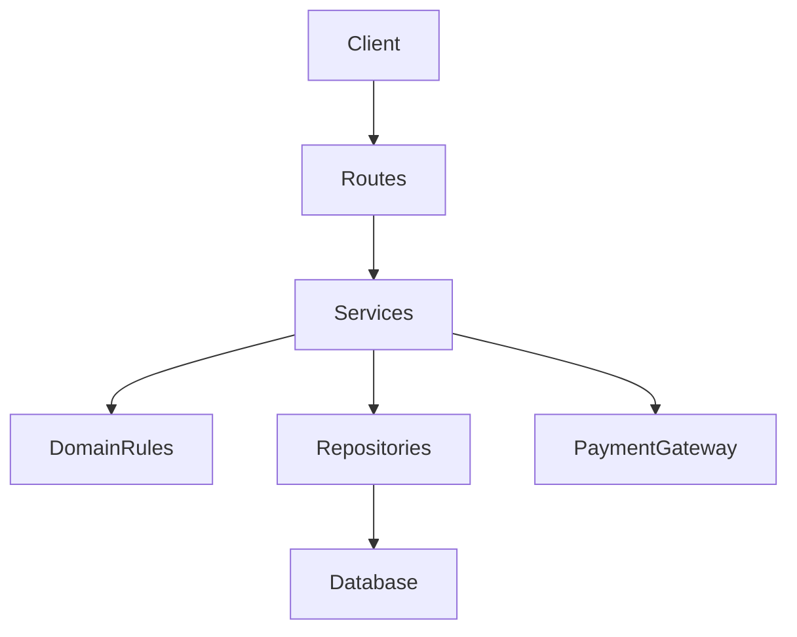
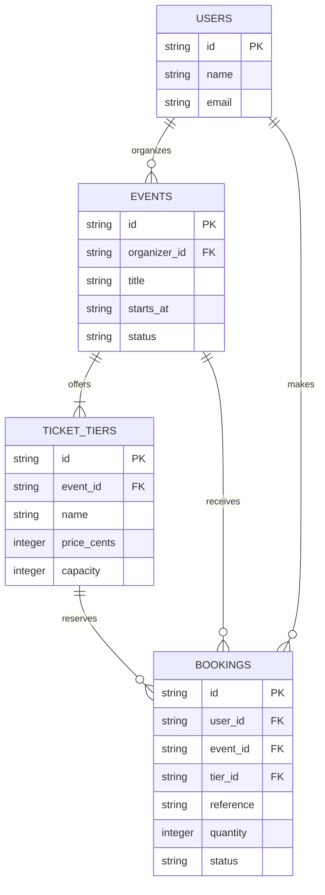
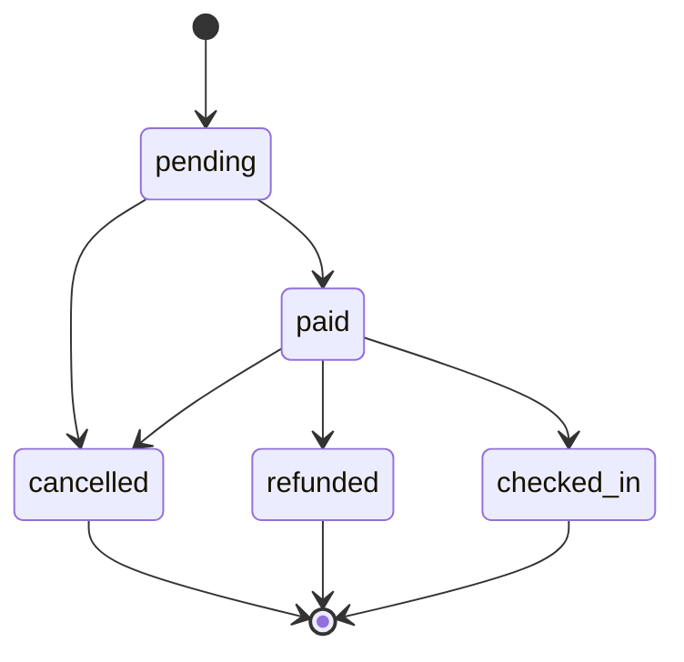

# Build 3: Architecture

## Layers

- **Routes** may interpret HTTP input, call services, and format responses; they
  may not implement business rules or access persistence directly.
- **Services** may coordinate domain rules and repositories; they may not
  depend on HTTP request/response details or call routes. External integrations,
  such as the payment gateway, are accessed through service dependencies.
- **Domain rules** may validate and apply business decisions; they may not
  perform I/O or depend on services, repositories, or routes.
- **Repositories** may read and write persistence; they may not implement
  booking policy or depend on services or routes.

Dependencies point inward: routes call services, and services call domain
rules and repositories. Nothing calls upward into a higher layer.

## Data model

## Booking life cycle

Only the transitions shown are valid. Cancelled, refunded, and checked-in
bookings are final states.
